# Circular dependencies

**Navigate:** [Index](index.md) · [Overview](overview.md) · [Dependencies](dependencies.md) · [Overview](overview.md) · [Index](index.md)

1 strongly connected component(s), 9 files, 9 edges inside the cycle. 1 elementary cycle(s) are listed below. Red edges are part of a cycle.

```mermaid
flowchart LR
  subgraph sg0["src"]
    n_src_main_tsx["main.tsx"]
  end
  subgraph sg1["src/discovery"]
    n_src_discovery_globLoader_ts["globLoader.ts"]
    n_src_discovery_themeDiscovery_ts["themeDiscovery.ts"]
  end
  subgraph sg2["src/hooks"]
    n_src_hooks_utils_ts["hooks/utils.ts"]
  end
  subgraph sg3["src/layout"]
    n_src_layout_index_tsx["layout/index.tsx"]
  end
  subgraph sg4["src/middleware/tools/PopoverTools"]
    n_src_middleware_tools_PopoverTools_ThemeMenu_tsx["ThemeMenu.tsx"]
  end
  subgraph sg5["src/middleware/windows"]
    n_src_middleware_windows_SettingsWindow_tsx["SettingsWindow.tsx"]
  end
  subgraph sg6["src/middleware/windows/settings"]
    n_src_middleware_windows_settings_LayoutPopover_tsx["LayoutPopover.tsx"]
    n_src_middleware_windows_settings_SettingsContent_tsx["SettingsContent.tsx"]
  end
  n_src_discovery_globLoader_ts --> n_src_hooks_utils_ts
  n_src_discovery_themeDiscovery_ts --> n_src_discovery_globLoader_ts
  n_src_hooks_utils_ts --> n_src_main_tsx
  n_src_layout_index_tsx --> n_src_middleware_windows_SettingsWindow_tsx
  n_src_main_tsx --> n_src_layout_index_tsx
  n_src_middleware_tools_PopoverTools_ThemeMenu_tsx --> n_src_discovery_themeDiscovery_ts
  n_src_middleware_windows_SettingsWindow_tsx --> n_src_middleware_windows_settings_SettingsContent_tsx
  n_src_middleware_windows_settings_LayoutPopover_tsx --> n_src_middleware_tools_PopoverTools_ThemeMenu_tsx
  n_src_middleware_windows_settings_SettingsContent_tsx --> n_src_middleware_windows_settings_LayoutPopover_tsx
  click n_src_main_tsx "../../src/main.tsx" "src/main.tsx"
  click n_src_discovery_globLoader_ts "../../src/discovery/globLoader.ts" "src/discovery/globLoader.ts"
  click n_src_discovery_themeDiscovery_ts "../../src/discovery/themeDiscovery.ts" "src/discovery/themeDiscovery.ts"
  click n_src_hooks_utils_ts "../../src/hooks/utils.ts" "src/hooks/utils.ts"
  click n_src_layout_index_tsx "../../src/layout/index.tsx" "src/layout/index.tsx"
  click n_src_middleware_tools_PopoverTools_ThemeMenu_tsx "../../src/middleware/tools/PopoverTools/ThemeMenu.tsx" "src/middleware/tools/PopoverTools/ThemeMenu.tsx"
  click n_src_middleware_windows_SettingsWindow_tsx "../../src/middleware/windows/SettingsWindow.tsx" "src/middleware/windows/SettingsWindow.tsx"
  click n_src_middleware_windows_settings_LayoutPopover_tsx "../../src/middleware/windows/settings/LayoutPopover.tsx" "src/middleware/windows/settings/LayoutPopover.tsx"
  click n_src_middleware_windows_settings_SettingsContent_tsx "../../src/middleware/windows/settings/SettingsContent.tsx" "src/middleware/windows/settings/SettingsContent.tsx"
  linkStyle 0,1,2,3,4,5,6,7,8 stroke:#c62828,stroke-width:2px,color:#c62828
  classDef mod fill:#e8f0fe,stroke:#3b6fb6,color:#000
  classDef ext fill:#f5f5f5,stroke:#9e9e9e,stroke-dasharray:4 3,color:#333
  classDef store fill:#fff7e0,stroke:#b58900,color:#000
  classDef sym fill:#f3e8ff,stroke:#7e57c2,color:#000
  classDef hookdef fill:#e0f7fa,stroke:#00838f,color:#000
  classDef entry fill:#e6f4ea,stroke:#2e7d32,color:#000
  classDef pipe fill:#e3f2fd,stroke:#1565c0,color:#000
```

**Elementary cycles** (runtime edges: value, JSX, re-export, hook use; type-only and dynamic imports excluded):

1. `globLoader.ts` → `hooks/utils.ts` → `main.tsx` → `layout/index.tsx` → `SettingsWindow.tsx` → `SettingsContent.tsx` → `LayoutPopover.tsx` → `ThemeMenu.tsx` → `themeDiscovery.ts` → `globLoader.ts`

**Root cause:** [src/hooks/utils.ts](../../src/hooks/utils.ts) line 1 imports `debug` from `@/main`. `@/main` resolves to [src/main.tsx](../../src/main.tsx) (file match wins over the `src/main/` directory), and `src/main.tsx` imports the layout shell, which reaches back to `hooks/utils.ts` through the windows, toolbars, and theme discovery.

**Suggestion (not applied; source is not modified):** move `debug` into a module with no UI imports (for example `src/lib/debug.ts`) and re-export it from `main.tsx` if other code needs `@/main`. This removes the edge from `hooks/utils.ts` to the app shell.

**Navigate:** [Index](index.md) · [Overview](overview.md) · [Dependencies](dependencies.md) · [Overview](overview.md) · [Index](index.md)
