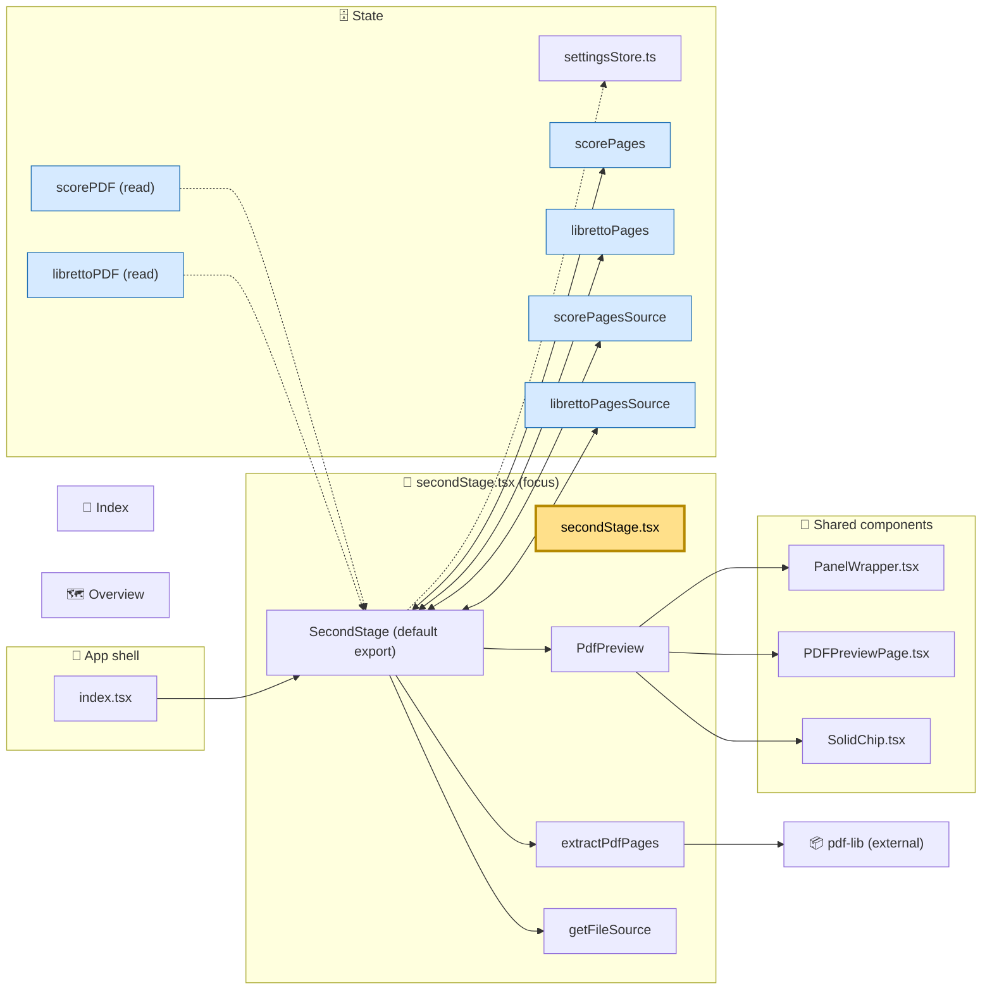

# 🚦 secondStage.tsx: focus view

> **Navigate:** [⬅️ Index](../index.md) · [🗺️ Overview](../overview.md) · [🗄️ Stores](../stores.md) · [🧩 Store properties](../store-properties.md) · [🧩 Mermaid source](./secondStage.mmd)

This page centres on [secondStage.tsx](../../../src/main/secondStage.tsx). It shows what the file imports, what it renders, which settings keys it reads and writes, and who renders it. It is hand-written and is not generated by `scripts/architecture/render.mjs`.

## 🗺️ Diagram

Solid arrows are containment or imports. Dotted arrows are reads. Double-headed arrows are reads and writes. The yellow node is the focus file. The blue nodes are settings keys.

> **Navigate:** [⬅️ Index](../index.md) · [🗺️ Overview](../overview.md) · [🗄️ Stores](../stores.md) · [🧩 Store properties](../store-properties.md) · [🧩 Mermaid source](./secondStage.mmd)

## 🔍 What the file does

- **Renders** two `PdfPreview` panels, `Score` and `Libretto`. Each shows its page count and a grid of `PDFPreviewPage` items.
- **Extracts pages** with `extractPdfPages`. It loads each PDF with `pdf-lib`, makes one single-page document per page, and wraps each one in a blob URL.
- **Caches** results. It reuses `scorePages`/`librettoPages` when `scorePagesSource`/`librettoPagesSource` match `getFileSource(file)`.
- **Writes** `scorePages`, `librettoPages`, and their `*Source` keys through `setSetting` after each extraction.
- **Reads** `scorePDF` and `librettoPDF`. A change to either re-runs the effect.

## ⚠️ Points to check

- Extraction failures are swallowed. `extractOrCached` returns an empty list, so the UI shows no pages and no error.
- Blob URLs from a previous run are revoked only when the effect is cancelled before its result is saved. Replaced pages are not revoked here.
- On reload, a cache hit (matching `*Source` key) returns the stored page list unchanged. Its blob URLs are already dead, so the previews can show broken images until the file is re-selected.
