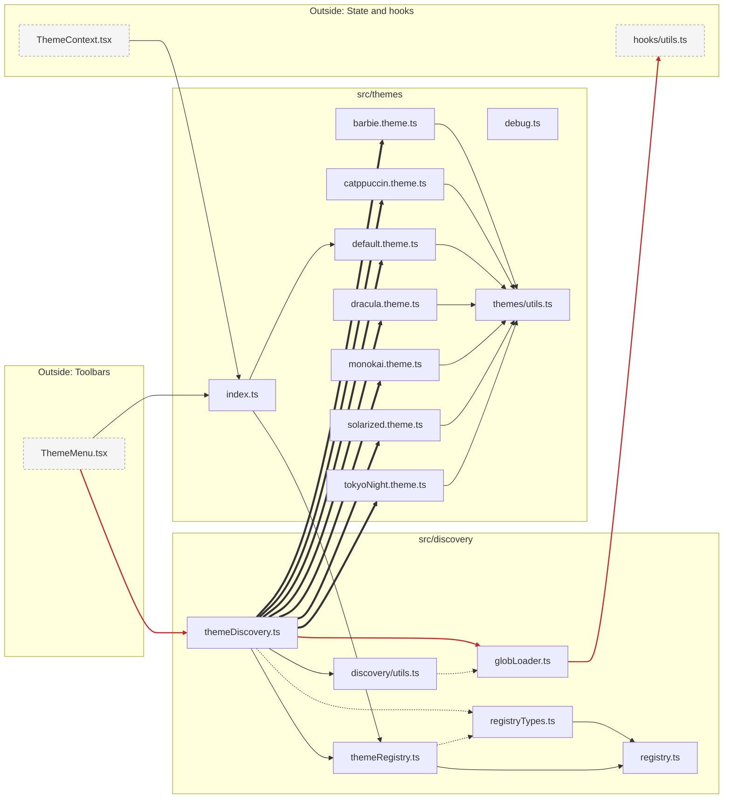

# Module: Discovery and themes

**Navigate:** [Index](../index.md) · [Overview](../overview.md) · [Cycles](../cycles.md) · [Dependencies](../dependencies.md)

Glob-based discovery of theme definitions, and the registry used to load them.

16 files. Cross-module edges: 3 incoming, 1 outgoing. Grey dashed nodes are files in other modules; clicking one opens that module's page.

**Imports and reverse dependencies (file level):**

| File | Imports | Imported by |
|---|---|---|
| [globLoader.ts](../../../src/discovery/globLoader.ts) | [hooks/utils.ts](../../../src/hooks/utils.ts) | [themeDiscovery.ts](../../../src/discovery/themeDiscovery.ts), [discovery/utils.ts](../../../src/discovery/utils.ts) |
| [registry.ts](../../../src/discovery/registry.ts) | — | [registryTypes.ts](../../../src/discovery/registryTypes.ts), [themeRegistry.ts](../../../src/discovery/themeRegistry.ts) |
| [registryTypes.ts](../../../src/discovery/registryTypes.ts) | [registry.ts](../../../src/discovery/registry.ts) | [themeDiscovery.ts](../../../src/discovery/themeDiscovery.ts), [themeRegistry.ts](../../../src/discovery/themeRegistry.ts) |
| [themeDiscovery.ts](../../../src/discovery/themeDiscovery.ts) | [globLoader.ts](../../../src/discovery/globLoader.ts), [registryTypes.ts](../../../src/discovery/registryTypes.ts), [themeRegistry.ts](../../../src/discovery/themeRegistry.ts), [discovery/utils.ts](../../../src/discovery/utils.ts), [barbie.theme.ts](../../../src/themes/barbie.theme.ts), [catppuccin.theme.ts](../../../src/themes/catppuccin.theme.ts), [default.theme.ts](../../../src/themes/default.theme.ts), [dracula.theme.ts](../../../src/themes/dracula.theme.ts), [monokai.theme.ts](../../../src/themes/monokai.theme.ts), [solarized.theme.ts](../../../src/themes/solarized.theme.ts), [tokyoNight.theme.ts](../../../src/themes/tokyoNight.theme.ts) | [ThemeMenu.tsx](../../../src/middleware/tools/PopoverTools/ThemeMenu.tsx) |
| [themeRegistry.ts](../../../src/discovery/themeRegistry.ts) | [registry.ts](../../../src/discovery/registry.ts), [registryTypes.ts](../../../src/discovery/registryTypes.ts) | [themeDiscovery.ts](../../../src/discovery/themeDiscovery.ts), [index.ts](../../../src/themes/index.ts) |
| [discovery/utils.ts](../../../src/discovery/utils.ts) | [globLoader.ts](../../../src/discovery/globLoader.ts) | [themeDiscovery.ts](../../../src/discovery/themeDiscovery.ts) |
| [barbie.theme.ts](../../../src/themes/barbie.theme.ts) | [themes/utils.ts](../../../src/themes/utils.ts) | [themeDiscovery.ts](../../../src/discovery/themeDiscovery.ts) |
| [catppuccin.theme.ts](../../../src/themes/catppuccin.theme.ts) | [themes/utils.ts](../../../src/themes/utils.ts) | [themeDiscovery.ts](../../../src/discovery/themeDiscovery.ts) |
| [debug.ts](../../../src/themes/debug.ts) | — | — |
| [default.theme.ts](../../../src/themes/default.theme.ts) | [themes/utils.ts](../../../src/themes/utils.ts) | [themeDiscovery.ts](../../../src/discovery/themeDiscovery.ts), [index.ts](../../../src/themes/index.ts) |
| [dracula.theme.ts](../../../src/themes/dracula.theme.ts) | [themes/utils.ts](../../../src/themes/utils.ts) | [themeDiscovery.ts](../../../src/discovery/themeDiscovery.ts) |
| [index.ts](../../../src/themes/index.ts) | [themeRegistry.ts](../../../src/discovery/themeRegistry.ts), [default.theme.ts](../../../src/themes/default.theme.ts) | [ThemeContext.tsx](../../../src/context/ThemeContext.tsx), [ThemeMenu.tsx](../../../src/middleware/tools/PopoverTools/ThemeMenu.tsx) |
| [monokai.theme.ts](../../../src/themes/monokai.theme.ts) | [themes/utils.ts](../../../src/themes/utils.ts) | [themeDiscovery.ts](../../../src/discovery/themeDiscovery.ts) |
| [solarized.theme.ts](../../../src/themes/solarized.theme.ts) | [themes/utils.ts](../../../src/themes/utils.ts) | [themeDiscovery.ts](../../../src/discovery/themeDiscovery.ts) |
| [tokyoNight.theme.ts](../../../src/themes/tokyoNight.theme.ts) | [themes/utils.ts](../../../src/themes/utils.ts) | [themeDiscovery.ts](../../../src/discovery/themeDiscovery.ts) |
| [themes/utils.ts](../../../src/themes/utils.ts) | — | [barbie.theme.ts](../../../src/themes/barbie.theme.ts), [catppuccin.theme.ts](../../../src/themes/catppuccin.theme.ts), [default.theme.ts](../../../src/themes/default.theme.ts), [dracula.theme.ts](../../../src/themes/dracula.theme.ts), [monokai.theme.ts](../../../src/themes/monokai.theme.ts), [solarized.theme.ts](../../../src/themes/solarized.theme.ts), [tokyoNight.theme.ts](../../../src/themes/tokyoNight.theme.ts) |

**Navigate:** [Index](../index.md) · [Overview](../overview.md) · [Cycles](../cycles.md) · [Dependencies](../dependencies.md)
