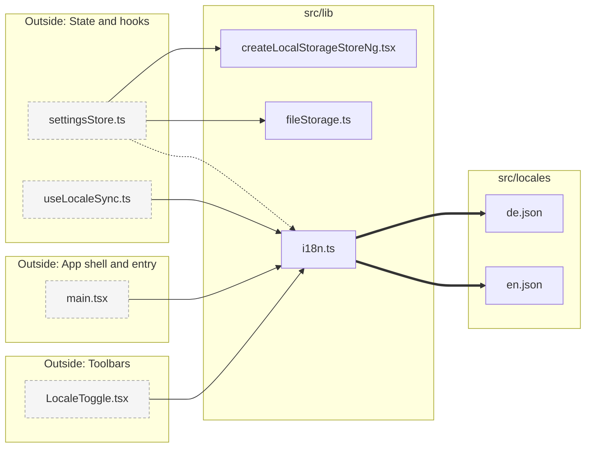

# Module: Library and locales

**Navigate:** [Index](../index.md) · [Overview](../overview.md) · [Stores](../stores.md) · [Dependencies](../dependencies.md)

Store factory, IndexedDB file storage, i18n loader, and locale JSON.

5 files. Cross-module edges: 6 incoming, 0 outgoing. Grey dashed nodes are files in other modules; clicking one opens that module's page.

**Imports and reverse dependencies (file level):**

| File | Imports | Imported by |
|---|---|---|
| [createLocalStorageStoreNg.tsx](../../../src/lib/createLocalStorageStoreNg.tsx) | — | [settingsStore.ts](../../../src/context/settingsStore.ts) |
| [fileStorage.ts](../../../src/lib/fileStorage.ts) | — | [settingsStore.ts](../../../src/context/settingsStore.ts) |
| [i18n.ts](../../../src/lib/i18n.ts) | [de.json](../../../src/locales/de.json), [en.json](../../../src/locales/en.json) | [settingsStore.ts](../../../src/context/settingsStore.ts), [useLocaleSync.ts](../../../src/hooks/useLocaleSync.ts), [main.tsx](../../../src/main.tsx), [LocaleToggle.tsx](../../../src/middleware/tools/MixedTools/LocaleToggle.tsx) |
| [de.json](../../../src/locales/de.json) | — | [i18n.ts](../../../src/lib/i18n.ts) |
| [en.json](../../../src/locales/en.json) | — | [i18n.ts](../../../src/lib/i18n.ts) |

**Navigate:** [Index](../index.md) · [Overview](../overview.md) · [Stores](../stores.md) · [Dependencies](../dependencies.md)
