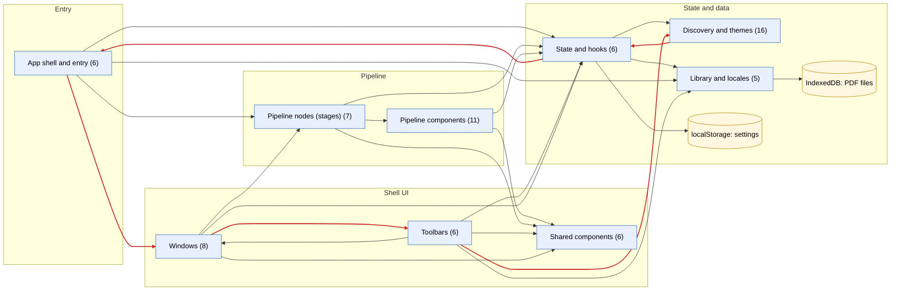

# Architecture overview

**Navigate:** [Index](index.md) · [Dependencies](dependencies.md) · [Components](components.md) · [Hooks](hooks.md) · [Stores](stores.md) · [Pipeline](pipeline.md) · [Cycles](cycles.md)

High-level view. Entry point: [src/main.tsx](../../src/main.tsx) mounts providers and the layout shell. Red edges are part of a circular dependency between modules.

**Modules** (click to open each diagram):

| Module | Files | In | Out | Purpose |
|---|---|---|---|---|
| [Pipeline components](modules/pipeline-components.md) | 11 | 7 | 15 | Reusable widgets used by the four pipeline stages (pickers, page views, composer). |
| [Pipeline nodes (stages)](modules/pipeline-nodes.md) | 7 | 2 | 12 | The pipeline router (`index.tsx`), the step buttons, and the four stage screens. |
| [Windows](modules/windows.md) | 8 | 4 | 13 | Overlay windows (settings, new-version notice) and the header. |
| [Toolbars](modules/toolbars.md) | 6 | 7 | 17 | Toolbar buttons and popovers (theme, locale, settings toggle). |
| [Shared components](modules/shared-components.md) | 6 | 18 | 0 | Generic UI primitives (chips, toggles, settings section). |
| [State and hooks](modules/state-hooks.md) | 6 | 23 | 6 | The settings store, theme context, and custom hooks. |
| [Discovery and themes](modules/discovery-themes.md) | 16 | 3 | 1 | Glob-based discovery of theme definitions, and the registry used to load them. |
| [Library and locales](modules/lib-locales.md) | 5 | 6 | 0 | Store factory, IndexedDB file storage, i18n loader, and locale JSON. |
| [App shell and entry](modules/app-shell.md) | 6 | 1 | 7 | Entry point (`src/main.tsx`), providers, and the layout shell. |

**Major data flows:** the settings store (`localStorage`) drives `pipelineStep` and the pipeline stages; PDF files are kept in IndexedDB; theme definitions are discovered through globs and loaded into the theme context.

**Navigate:** [Index](index.md) · [Dependencies](dependencies.md) · [Components](components.md) · [Hooks](hooks.md) · [Stores](stores.md) · [Pipeline](pipeline.md) · [Cycles](cycles.md)
