# 🗄️ Settings store properties

> **Navigate:** [⬅️ Index](./index.md) · [🗄️ Stores diagram](./stores.md) · [🧭 Overview](./overview.md) · [🧩 Mermaid source](./store-properties.mmd)

This page tracks every property of the `SettingsStore` defined in [settingsStore.ts](../../src/context/settingsStore.ts). It lists who reads and writes each property and how it is persisted.

> ⚠️ **Hand-written.** `scripts/architecture/render.mjs` does not generate this page or its diagram. Update both by hand when the store changes. For the generated symbol and consumer view, see [stores.md](./stores.md).

## 🗺️ Diagram

Solid arrows are writes (consumer → property). Dotted arrows are reads (property → consumer). The dashed yellow node has no reader. Click a file node to open its source. The same diagram is in [store-properties.mmd](./store-properties.mmd).

```mermaid
flowchart LR
  nav_index["🧭 Index"]
  nav_stores["🗄️ Stores"]
  click nav_index "./index.md" "Architecture index"
  click nav_stores "./stores.md" "State stores"

  subgraph ls["💾 localStorage under settingsStore"]
    p_pipelineStep["pipelineStep"]
    p_librettoPages["librettoPages"]
    p_scorePages["scorePages"]
    p_librettoPagesSource["librettoPagesSource"]
    p_scorePagesSource["scorePagesSource"]
    p_librettoPageSelections["librettoPageSelections"]
    p_librettoReflowSelections["librettoReflowSelections"]
    p_activePage["activePage"]
    p_activePageScrollPosition["activePageScrollPosition"]
    p_newVersion["newVersion"]
    p_themeMode["themeMode"]
    p_themeId["themeId"]
    p_previewPhotoObj["previewPhotoObj ⚠️ no reader"]
    p_showSettings["showSettings"]
    p_locale["locale"]
  end

  subgraph idb["🗃️ IndexedDB via file keys"]
    p_librettoPDF["librettoPDF"]
    p_scorePDF["scorePDF"]
  end

  subgraph pipe["🚦 Pipeline"]
    f_StepperButtons["StepperButtons.tsx"]
    f_index["index.tsx"]
    f_firstStage["firstStage.tsx"]
    f_secondStage["secondStage.tsx"]
    f_LibrettoPicker["LibrettoPicker.tsx"]
    f_ScorePicker["ScorePicker.tsx"]
    f_ReviewPicker["ReviewPicker.tsx"]
    f_PDFComposer["PDFComposer.tsx"]
    f_LibrettoPage["LibrettoPage.tsx"]
    f_ScorePage["ScorePage.tsx"]
  end

  subgraph win["🪟 Windows and tools"]
    f_SettingsWindowToggle["SettingsWindowToggle.tsx"]
    f_SettingsWindow["SettingsWindow.tsx"]
    f_NewVersionWindow["NewVersionWindow.tsx"]
    f_NewVersionDialog["newVersion/NewVersionWindow.tsx"]
    f_DarkLightStatus["DarkLightStatus.tsx"]
    f_ThemeMenu["ThemeMenu.tsx"]
    f_LocaleToggle["LocaleToggle.tsx"]
  end

  subgraph app["🚀 App shell and 🎨 themes"]
    f_main["main.tsx"]
    f_ThemeContext["ThemeContext.tsx"]
    f_useLocaleSync["useLocaleSync.ts"]
  end

  %% writers
  f_StepperButtons --> p_pipelineStep
  f_firstStage --> p_librettoPDF
  f_firstStage --> p_scorePDF
  f_secondStage --> p_librettoPages
  f_secondStage --> p_scorePages
  f_secondStage --> p_librettoPagesSource
  f_secondStage --> p_scorePagesSource
  f_LibrettoPage --> p_librettoPageSelections
  f_LibrettoPage --> p_librettoReflowSelections
  f_ScorePage --> p_librettoReflowSelections
  f_ScorePage --> p_activePage
  f_ScorePage --> p_activePageScrollPosition
  f_main --> p_newVersion
  f_NewVersionDialog --> p_newVersion
  f_DarkLightStatus --> p_themeMode
  f_ThemeContext --> p_themeMode
  f_ThemeContext --> p_themeId
  f_ThemeMenu --> p_themeId
  f_SettingsWindowToggle --> p_showSettings
  f_SettingsWindow --> p_showSettings
  f_LocaleToggle --> p_locale
  %% readers
  p_pipelineStep -.-> f_StepperButtons
  p_pipelineStep -.-> f_index
  p_librettoPDF -.-> f_firstStage
  p_librettoPDF -.-> f_LibrettoPicker
  p_librettoPDF -.-> f_PDFComposer
  p_librettoPDF -.-> f_secondStage
  p_scorePDF -.-> f_firstStage
  p_scorePDF -.-> f_ScorePicker
  p_scorePDF -.-> f_PDFComposer
  p_scorePDF -.-> f_secondStage
  p_librettoPages -.-> f_ScorePicker
  p_librettoPages -.-> f_ReviewPicker
  p_librettoPages -.-> f_PDFComposer
  p_librettoPages -.-> f_secondStage
  p_scorePages -.-> f_ScorePicker
  p_scorePages -.-> f_ReviewPicker
  p_scorePages -.-> f_PDFComposer
  p_scorePages -.-> f_secondStage
  p_librettoPagesSource -.-> f_secondStage
  p_scorePagesSource -.-> f_secondStage
  p_librettoPageSelections -.-> f_LibrettoPage
  p_librettoReflowSelections -.-> f_ScorePage
  p_activePage -.-> f_ScorePage
  p_activePage -.-> f_LibrettoPage
  p_activePage -.-> f_ReviewPicker
  p_activePage -.-> f_ScorePicker
  p_activePageScrollPosition -.-> f_ScorePage
  p_activePageScrollPosition -.-> f_LibrettoPage
  p_activePageScrollPosition -.-> f_ReviewPicker
  p_activePageScrollPosition -.-> f_ScorePicker
  p_newVersion -.-> f_NewVersionWindow
  p_themeMode -.-> f_ThemeContext
  p_themeMode -.-> f_DarkLightStatus
  p_themeId -.-> f_ThemeContext
  p_themeId -.-> f_ThemeMenu
  p_showSettings -.-> f_SettingsWindowToggle
  p_showSettings -.-> f_SettingsWindow
  p_locale -.-> f_useLocaleSync
  p_locale -.-> f_LocaleToggle

  click f_StepperButtons "../../src/main/StepperButtons.tsx" "src/main/StepperButtons.tsx"
  click f_index "../../src/main/index.tsx" "src/main/index.tsx"
  click f_firstStage "../../src/main/firstStage.tsx" "src/main/firstStage.tsx"
  click f_secondStage "../../src/main/secondStage.tsx" "src/main/secondStage.tsx"
  click f_LibrettoPicker "../../src/main/components/LibrettoPicker.tsx" "src/main/components/LibrettoPicker.tsx"
  click f_ScorePicker "../../src/main/components/ScorePicker.tsx" "src/main/components/ScorePicker.tsx"
  click f_ReviewPicker "../../src/main/components/ReviewPicker.tsx" "src/main/components/ReviewPicker.tsx"
  click f_PDFComposer "../../src/main/components/PDFComposer.tsx" "src/main/components/PDFComposer.tsx"
  click f_LibrettoPage "../../src/main/components/LibrettoPage.tsx" "src/main/components/LibrettoPage.tsx"
  click f_ScorePage "../../src/main/components/ScorePage.tsx" "src/main/components/ScorePage.tsx"
  click f_SettingsWindowToggle "../../src/middleware/tools/ActionTools/SettingsWindowToggle.tsx" "SettingsWindowToggle.tsx"
  click f_SettingsWindow "../../src/middleware/windows/SettingsWindow.tsx" "SettingsWindow.tsx"
  click f_NewVersionWindow "../../src/middleware/windows/NewVersionWindow.tsx" "NewVersionWindow.tsx"
  click f_NewVersionDialog "../../src/middleware/windows/newVersion/NewVersionWindow.tsx" "newVersion/NewVersionWindow.tsx"
  click f_DarkLightStatus "../../src/middleware/tools/ActionTools/DarkLightStatus.tsx" "DarkLightStatus.tsx"
  click f_ThemeMenu "../../src/middleware/tools/PopoverTools/ThemeMenu.tsx" "ThemeMenu.tsx"
  click f_LocaleToggle "../../src/middleware/tools/MixedTools/LocaleToggle.tsx" "LocaleToggle.tsx"
  click f_main "../../src/main.tsx" "src/main.tsx"
  click f_ThemeContext "../../src/context/ThemeContext.tsx" "src/context/ThemeContext.tsx"
  click f_useLocaleSync "../../src/hooks/useLocaleSync.ts" "src/hooks/useLocaleSync.ts"

  classDef dead stroke-dasharray: 4 3,fill:#fff3cd,stroke:#b58900
  class p_previewPhotoObj dead
```

> **Navigate:** [⬅️ Index](./index.md) · [🗄️ Stores diagram](./stores.md) · [🧭 Overview](./overview.md) · [🧩 Mermaid source](./store-properties.mmd)

## 💾 Persistence model

## 💾 Persistence model

- The store is created with `createLocalStorageStoreNg` ([createLocalStorageStoreNg.tsx](../../src/lib/createLocalStorageStoreNg.tsx)).
- The whole object is written to `localStorage` under the key `settingsStore` on every change. It is read back on load and merged with the defaults.
- `File` values are dropped during serialization (`serialize` returns `undefined` for `File`). `librettoPDF` and `scorePDF` are therefore kept in IndexedDB through `fileStorageKeys`, not in `localStorage`.
- ⚠️ `librettoPages` and `scorePages` are persisted with their `url` fields. Those URLs come from `URL.createObjectURL` in [secondStage.tsx](../../src/main/secondStage.tsx), so they are stale after a reload. Treat them as session-only.

## 📋 Property table

Legend: 💾 `localStorage` · 🗃️ IndexedDB (via file keys) · 🧠 memory only.

| Property | Type | Default | Persistence | Readers | Writers |
|---|---|---|---|---|---|
| `pipelineStep` | `number` | `0` | 💾 | [StepperButtons](../../src/main/StepperButtons.tsx), [index.tsx](../../src/main/index.tsx) | [StepperButtons](../../src/main/StepperButtons.tsx) (64, 77) |
| `librettoPDF` | `File \| undefined` | `undefined` | 🗃️ | [firstStage.tsx](../../src/main/firstStage.tsx), [LibrettoPicker](../../src/main/components/LibrettoPicker.tsx), [PDFComposer](../../src/main/components/PDFComposer.tsx), [secondStage.tsx](../../src/main/secondStage.tsx) | [firstStage.tsx](../../src/main/firstStage.tsx) (85, 91) |
| `scorePDF` | `File \| undefined` | `undefined` | 🗃️ | [firstStage.tsx](../../src/main/firstStage.tsx), [ScorePicker](../../src/main/components/ScorePicker.tsx), [PDFComposer](../../src/main/components/PDFComposer.tsx), [secondStage.tsx](../../src/main/secondStage.tsx) | [firstStage.tsx](../../src/main/firstStage.tsx) (85, 91) |
| `librettoPages` | `any[]` | `[]` | 💾 (blob URLs go stale) | [ScorePicker](../../src/main/components/ScorePicker.tsx), [ReviewPicker](../../src/main/components/ReviewPicker.tsx), [PDFComposer](../../src/main/components/PDFComposer.tsx), [secondStage.tsx](../../src/main/secondStage.tsx) | [secondStage.tsx](../../src/main/secondStage.tsx) (121) |
| `scorePages` | `any[]` | `[]` | 💾 (blob URLs go stale) | [ScorePicker](../../src/main/components/ScorePicker.tsx), [ReviewPicker](../../src/main/components/ReviewPicker.tsx), [PDFComposer](../../src/main/components/PDFComposer.tsx), [secondStage.tsx](../../src/main/secondStage.tsx) | [secondStage.tsx](../../src/main/secondStage.tsx) (121) |
| `librettoPagesSource` | `string \| undefined` | `undefined` | 💾 | [secondStage.tsx](../../src/main/secondStage.tsx) (80–86, cache check) | [secondStage.tsx](../../src/main/secondStage.tsx) (125) |
| `scorePagesSource` | `string \| undefined` | `undefined` | 💾 | [secondStage.tsx](../../src/main/secondStage.tsx) (80–86, cache check) | [secondStage.tsx](../../src/main/secondStage.tsx) (126) |
| `librettoPageSelections` | `Record<number, [number, number][]>` | `{}` | 💾 | [LibrettoPage](../../src/main/components/LibrettoPage.tsx) | [LibrettoPage](../../src/main/components/LibrettoPage.tsx) (41, 51, 80) |
| `librettoReflowSelections` | `LibrettoReflowSelection[]` | `[]` | 💾 | [ScorePage](../../src/main/components/ScorePage.tsx) | [LibrettoPage](../../src/main/components/LibrettoPage.tsx) (63), [ScorePage](../../src/main/components/ScorePage.tsx) (34, delete) |
| `activePage` | `number \| undefined` | `undefined` | 💾 | [ScorePage](../../src/main/components/ScorePage.tsx), [LibrettoPage](../../src/main/components/LibrettoPage.tsx), [ReviewPicker](../../src/main/components/ReviewPicker.tsx), [ScorePicker](../../src/main/components/ScorePicker.tsx) | [ScorePage](../../src/main/components/ScorePage.tsx) (31) |
| `activePageScrollPosition` | `number` | `0` | 💾 | [ScorePage](../../src/main/components/ScorePage.tsx), [LibrettoPage](../../src/main/components/LibrettoPage.tsx), [ReviewPicker](../../src/main/components/ReviewPicker.tsx), [ScorePicker](../../src/main/components/ScorePicker.tsx) | [ScorePage](../../src/main/components/ScorePage.tsx) (87) |
| `newVersion` | `boolean \| undefined` | `undefined` | 💾 | [NewVersionWindow](../../src/middleware/windows/NewVersionWindow.tsx) (6–8) | [main.tsx](../../src/main.tsx) (48), [newVersion/NewVersionWindow](../../src/middleware/windows/newVersion/NewVersionWindow.tsx) (29, 37) |
| `themeMode` | `'light' \| 'dark' \| undefined` | `undefined` | 💾 | [ThemeContext](../../src/context/ThemeContext.tsx), [DarkLightStatus](../../src/middleware/tools/ActionTools/DarkLightStatus.tsx) | [DarkLightStatus](../../src/middleware/tools/ActionTools/DarkLightStatus.tsx) (13), [ThemeContext](../../src/context/ThemeContext.tsx) (58) |
| `themeId` | `string` | theme default | 💾 | [ThemeContext](../../src/context/ThemeContext.tsx), [ThemeMenu](../../src/middleware/tools/PopoverTools/ThemeMenu.tsx) | [ThemeContext](../../src/context/ThemeContext.tsx) (69), [ThemeMenu](../../src/middleware/tools/PopoverTools/ThemeMenu.tsx) (33) |
| `previewPhotoObj` | `string \| undefined` | `undefined` | 💾 | None found | None found. Only the `setPreviewPhotoObj` action defines it ([settingsStore.ts](../../src/context/settingsStore.ts) 238–241). |
| `showSettings` | `boolean` | `false` | 💾 | [SettingsWindowToggle](../../src/middleware/tools/ActionTools/SettingsWindowToggle.tsx), [SettingsWindow](../../src/middleware/windows/SettingsWindow.tsx) | [SettingsWindowToggle](../../src/middleware/tools/ActionTools/SettingsWindowToggle.tsx) (12), [SettingsWindow](../../src/middleware/windows/SettingsWindow.tsx) (18) |
| `locale` | `SupportedLanguage` | default locale | 💾 | [useLocaleSync](../../src/hooks/useLocaleSync.ts), [LocaleToggle](../../src/middleware/tools/MixedTools/LocaleToggle.tsx) | [LocaleToggle](../../src/middleware/tools/MixedTools/LocaleToggle.tsx) (31) |

## 🔍 Notes and open items

- `previewPhotoObj` has a setter action but no reader or caller in `src/`. Treat it as possibly dead state.
- The `*PagesSource` keys are only used for the cache check in `secondStage.tsx`.
- Line numbers were taken from a read of the source during this review. Re-check them after edits.
- Paths in this table are relative to this file. The `src/` links resolve from `docs/architecture/`.
